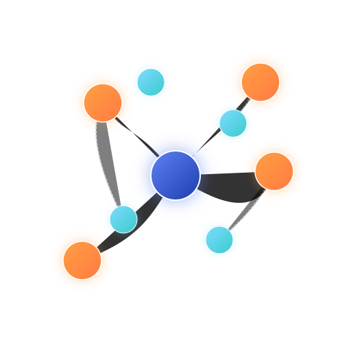

<div align="center">
  
</div>

# pAPI – Python/Pluggable API Framework

[](https://mcpampel.com/repo/efirvida/papi)

**pAPI** is a modular micro-framework built on top of FastAPI for composing scalable, tool-oriented APIs. It extends FastAPI’s routing system with native support for modular service architectures, app discovery, and LLM tooling.

> 📚 **Documentation**: Full documentation is currently a work in progress (WIP).  
> 👉 [https://efirvida.github.io/pAPI/](https://efirvida.github.io/pAPI/)  
> 🧪 Example apps are available in the [`extra_apps` branch](https://github.com/efirvida/pAPI/tree/extra_apps)

---

## ✨ Key Features

- 🔌 **Plug-and-Play Architecture**  
  Modular app system with automatic route discovery and dependency resolution.

- 🧠 **LLM Tooling & MCP Integration**  
  Expose endpoints as tools for agent frameworks using SSE and standard response models.

- 🧬 **Multi-Database Support**  
  Native support for MongoDB (Beanie), SQL databases (SQLAlchemy), and Redis.

- 📦 **Standardized API Responses**  
  Unified success/error format with automatic metadata injection and exception handling.

- ⚡ **Performance-Optimized**  
  Fully async, lazily loaded, and built on FastAPI’s high-performance core.

- 🛠️ **Developer Tooling**  
  Async-enabled IPython shell for rapid development.

---

## 🧩 App System

pAPI is built around a **composable app architecture**, where each app functions like a LEGO® piece—self-contained, reusable, and designed to interlock with others.

These apps can:

* Register API routes (`RESTRouter`)
* Define database models (Beanie or SQLAlchemy)
* Hook into startup, shutdown processes (`AppSetupHook`)

Together, they form a cohesive and scalable API system, enabling you to build robust, modular services by simply connecting or extending the building blocks your application needs.

Apps are declared in `config.yaml`, allowing clean separation of concerns and easy configuration.

---

## 📊 Use Cases

- **AI Agent Tooling**  
  Build modular tools for LLMs and agents.

- **Composable Microservices**  
  Create reusable, pluggable service components.

- **Rapid API Prototyping**  
  Launch structured APIs quickly with standardized behavior.

- **Security and Auth Systems**  
  Implement RBAC/ABAC policies using app-based security modules.

---

## 🚀 Getting Started

```bash
git clone https://github.com/efirvida/pAPI.git
cd pAPI
rye sync
rye run python papi/cli.py --help
````

---

## 🧠 Learn More

Check the documentation for:

* App development
* CLI usage
* Response formatting
* Database integrations
* MCP/LLM support

👉 [https://efirvida.github.io/pAPI/](https://efirvida.github.io/pAPI/)

---

## 🤝 Contributing

1. Fork the repository
2. Create a feature branch (`git checkout -b feature/my-feature`)
3. Commit your changes
4. Push and open a Pull Request

---

## 🪪 License

MIT License © 2025 — Eduardo Miguel Firvida Donestevez

